

  
  <h1>THLDYTV · 沉浸式大屏时钟与氛围终端</h1>
  
<strong>🕰️ 为 Apple TV (tvOS) 倾力打造的艺术时钟、自然声景白噪音与番茄专注系统</strong>

  
  

    
    
    
    
  

  

    
  

> **📢 项目说明：** 本项目核心由 **THLClockFramework** 驱动，是一套专为客厅与工作台大屏幕定制的高性能时间呈现与氛围营造系统。深度契合 Apple tvOS 原生设计规范与 Siri Remote 交互体验，将闲置电视化身为兼具实用性与艺术美感的时间中枢。

---

## 🌟 核心特性与设计哲学 (Features)

### 🎨 16 款精心雕琢的艺术表盘
针对客厅大屏远距离观赏（10-foot UI）与高对比度显示特性，内置了 16 种不同风格的独立主题视图，随时随心切换：
* **极客控制台 (Geek Dashboard)**：工业极客风仪表盘，集成实时系统心跳、毫秒级时钟、运行指标监控与多维度动态面板。
* **复古翻页钟 (Flip Clock)**：拟真机械翻牌质感，还原经典的翻牌落位动效，为客厅带来厚重的复古时间韵味。
* **太阳系星轨 (Solar System)**：以天体物理轨道为灵感，行星沿公转轨道静谧运行，在 OLED 纯黑背景上呈现浩瀚星空。
* **经典指针模拟 (Analog Clock)**：包豪斯极简指针刻度，优雅平滑的秒针扫动动效，满足永不过时的经典美学。
* **赛博霓虹 (Cyber Neon)**：高饱和双色辉光发光字，未来感科技光效。
* **工业点阵 (Dot Matrix)**：经典点阵发光与像素质感，沉稳工控风格。
* **动态流光渐变 (Dynamic Gradient)**：柔和多色光晕实时流动，呼吸般的光感变化与室内氛围灯完美辉映。
* **更多创意表盘**：排版艺术 (Typographic)、十六进制色彩 (Hex Clock)、二进制代码 (Binary Clock)、海浪呼吸 (Wave Clock)、赛博故障 (Glitch Clock)、方块矩阵 (Text Grid) 等。

---

### 🍃 沉浸式自然声景与白噪音系统 (Ambient Audio)
由 `ClockAmbientAudioManager` 统一调度的全天候大屏氛围声音引擎：
* **4 种高保真环绕声景**：
  * **细雨淅沥 (Gentle Rain)**：窗外绵绵细雨，舒缓降噪，打造独享专注空间；
  * **壁炉柴火 (Campfire Hearth)**：温暖木炭微爆，静谧舒适的客厅伴侣；
  * **浩瀚海浪 (Ocean Waves)**：潮汐起伏深呼吸，助眠与冥想首选；
  * **静心钟摆 (Zen Pendulum)**：古朴机械节拍，律动心流。
* **系统级混音与后台播放**：深度配置 `AVAudioSession (.playback, options: [.mixWithOthers])`，支持与系统后台音频混合播放。
* **Now Playing 与遥控联动**：完整接入 `MPNowPlayingInfoCenter` 与 `MPRemoteCommandCenter`，支持 Siri Remote 控制中心播放/暂停控制。
* **定时休眠伴眠 (Sleep Timer)**：支持 15 / 30 / 45 / 60 分钟定时自动淡出与停止，陪伴安然入睡。

---

### 🍅 大屏番茄工作法与心流计时 (Pomodoro Focus)
内置遵循高效工作法的专注管理中枢 `ClockPomodoroManager`：
* **科学心流循环**：25 分钟高能专注 (Focus) + 5 分钟轻松休息 (Break) 自动化交替节奏。
* **大屏可视化进度**：高对比度动态圆环随时间流逝平滑填充，远距离一目了然，掌控全局进度。
* **声景深度联动**：开启专注模式可自动联动播放舒缓雨声白噪音，迅速切入工作状态。

---

### 📺 原生画中画悬浮常驻 (Picture-in-Picture)
严格遵循 Apple 原生画中画架构规范的悬浮时钟解决方案：
* **原生 AVPictureInPictureController 驱动**：采用 tvOS 系统级画中画引擎。
* **跨应用无缝随行**：返回 Apple TV 主屏幕、切换至其他应用或观看影片时，时钟与番茄倒计时浮窗可在屏幕右上角持续常驻，不错过任何重要时间节点。

---

### 🛡️ OLED 防烧屏与大屏常亮保护
* **防烧屏智能微位移**：表盘核心元素在静置时具备微像素周期位移机制，防止大屏电视或 OLED 屏幕长时间固定显示产生灼伤。
* **屏幕常亮自适应**：智能激活 `UIApplication.isIdleTimerDisabled`，确保时间终端在需要时永不黑屏休眠。
* **Siri Remote 原生焦点引擎**：左右轻扫平滑切换表盘主题，向下轻扫唤起多功能 Dock 控制台，操作直观优雅。

---

## 📸 全景图赏与功能矩阵 (Gallery)

### 01 / 经典美学与极客数据

  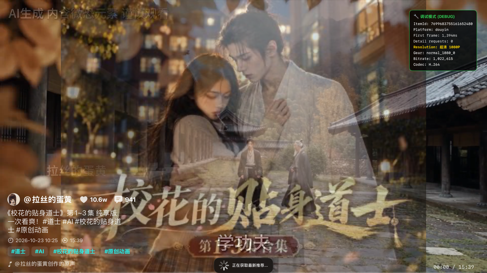
  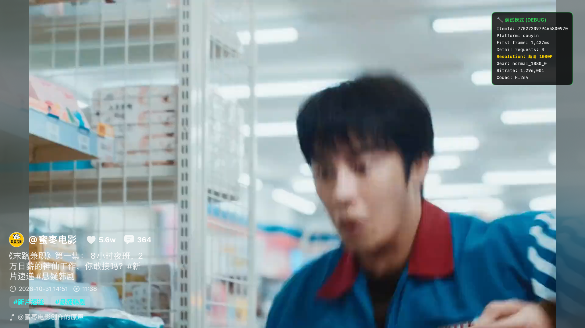
  
<b>左：极客控制台</b>（系统指标与精准时钟联动） · <b>右：复古翻页钟</b>（机械翻牌落位质感）

### 02 / 天文星轨与极简模拟

  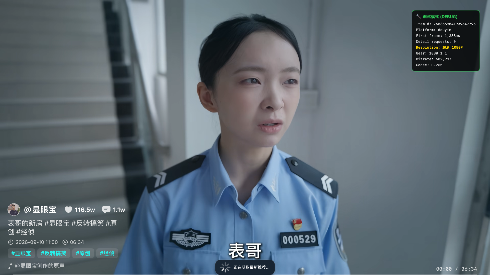
  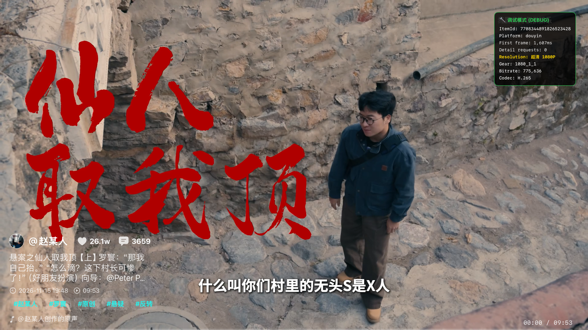
  
<b>左：太阳系星轨时钟</b>（行星运转时间映射） · <b>右：包豪斯经典指针</b>（高对比度极简走针）

### 03 / 未来霓虹与复古点阵

  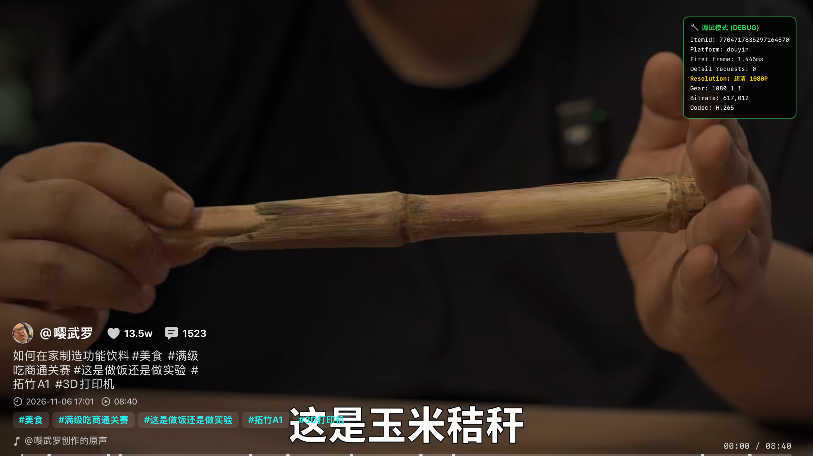
  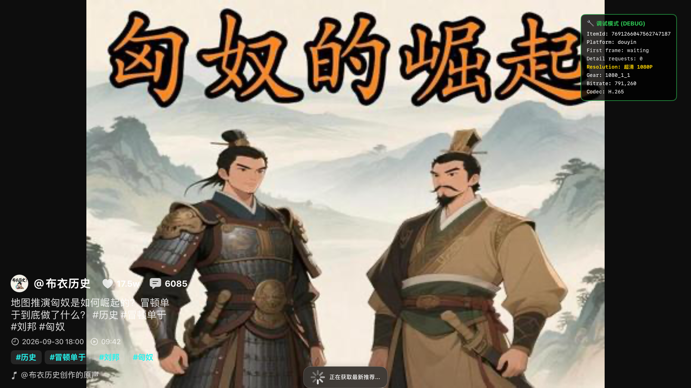
  
<b>左：赛博霓虹时钟</b>（高饱和辉光管视觉） · <b>右：工业点阵显示</b>（工控经典像素风）

### 04 / 动态流光渐变呼吸

  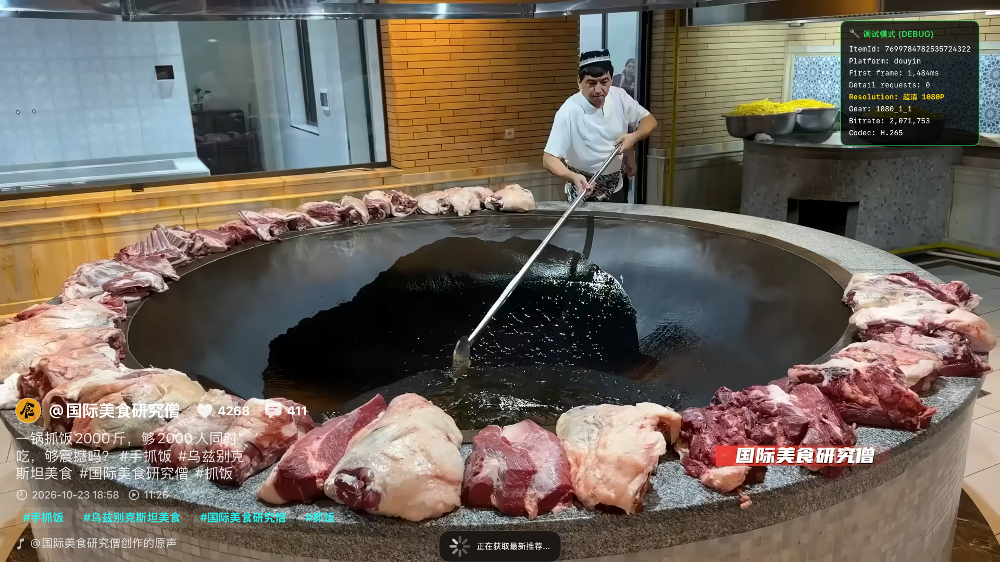
  
<b>动态渐变流光</b>：随时间缓缓流转的呼吸式色彩晕染，与客厅环境灯光相映成趣。

### 05 / 自然声景白噪音与番茄专注

  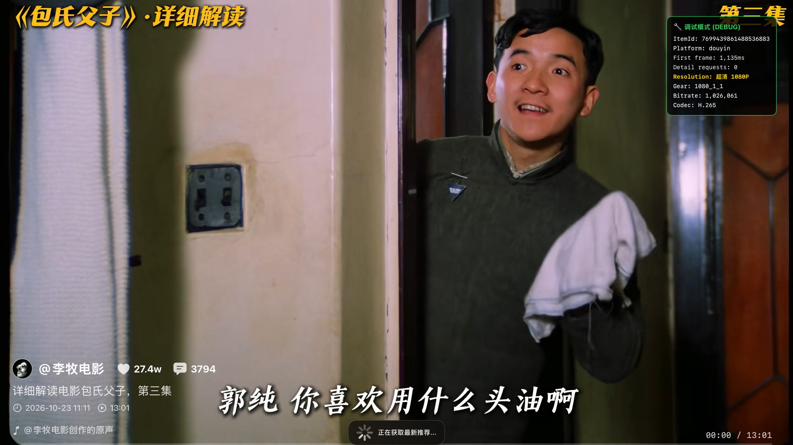
  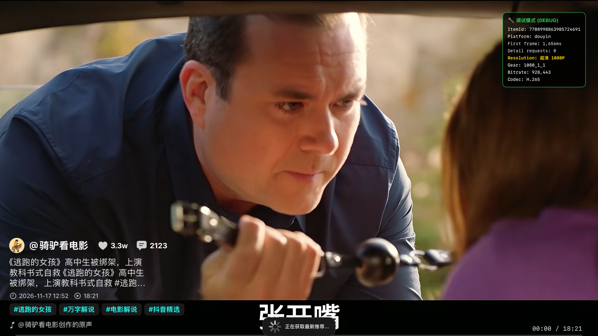
  
<b>左：自然声景白噪音选择面板</b> · <b>右：大屏番茄工作法心流计时器</b>

### 06 / 系统画中画常驻与全能设置

  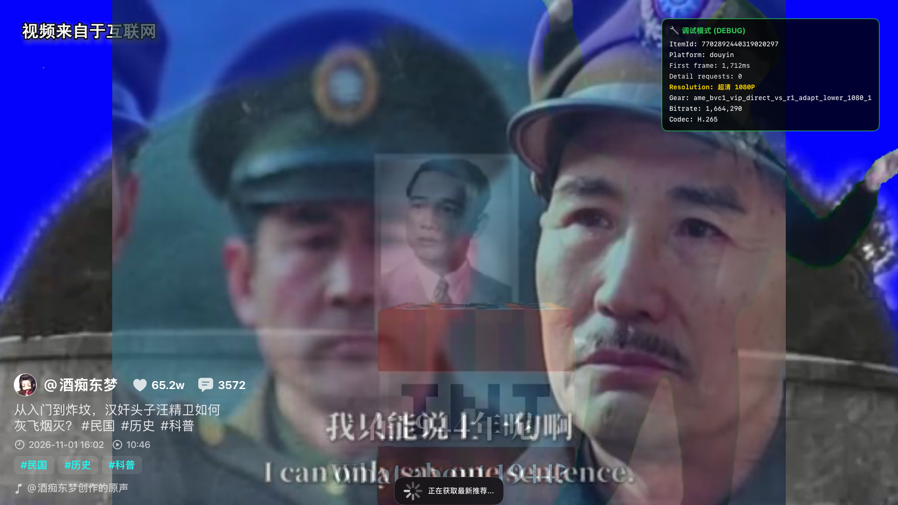
  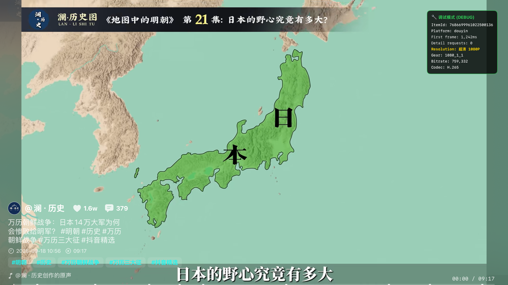
  
<b>左：tvOS 原生画中画桌面常驻效果</b> · <b>右：时钟偏好与个性化设置中心</b>

---

## 🏛️ 技术架构与模块规范 (Architecture)

`THLClockFramework` 采用严谨的分层设计模式与现代响应式编程范式（SwiftUI + Combine）：

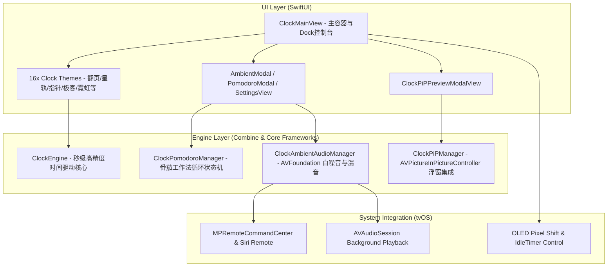

* **纯本地安全运行**：本框架无任何网络请求依赖，无需后端服务器，零用户隐私数据收集。
* **低 CPU/GPU 功耗开销**：精心调优的 SwiftUI 视图重绘层级，静态与动态元素严格解耦，长时间大屏运行保持极低能耗与设备发热。
* **高合规性**：严格契合 Apple 《App Store 审核指南》与《tvOS 人机交互指南 (HIG)》。

---

## 📄 隐私政策 (Privacy Policy)

本项目严格保护用户隐私，遵守苹果 App Store 隐私合规要求：
* 纯本地工具，无外部数据采集；
* 详细政策请查阅：[隐私政策 (Privacy Policy)](PrivacyPolicy.md)。

---

## 📝 许可证与声明 (Disclaimer)

本项目遵循个人研究与技术展示规范。所有展示素材与交互逻辑均为原生开发技术呈现。如有任何技术问题或建议，欢迎提交 Issue。
