

  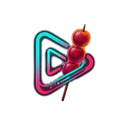
  <h1>THLDYTV · 沉浸式大屏时钟与氛围终端</h1>
  
<strong>🕰️ 为 Apple TV (tvOS) 倾力打造的艺术时钟、自然声景白噪音与番茄专注系统</strong>

  
  

    
    
    
    
    
  

  

    
  

> **📢 项目说明：** 本项目核心由 **THLClockFramework** 驱动，是一套专为客厅与工作台大屏幕定制的高性能时间呈现与专注氛围营造系统。深度契合 Apple tvOS 原生设计规范与 Siri Remote 交互体验，将闲置电视化身为兼具实用性与艺术美感的时间中枢。

---

## 📸 核心特性全景导览 (App Store Official Showcase)

### 01 / 多元艺术时钟表盘矩阵

  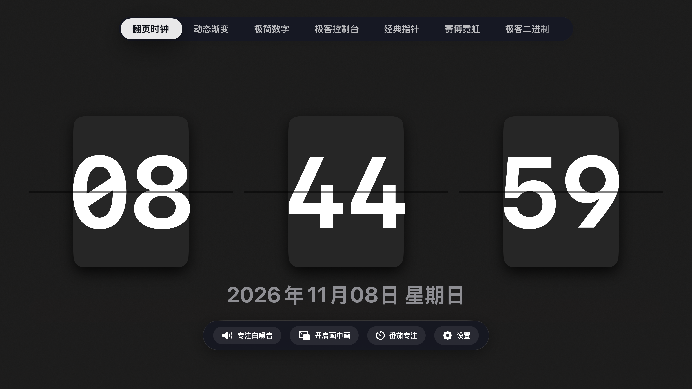
  
<em>涵盖复古机械翻牌、浩瀚太阳系星轨、包豪斯经典指针、工业发光点阵、未来赛博霓虹等 16 款独家调校主题。</em>

### 02 / 专注白噪音与自然声景系统

  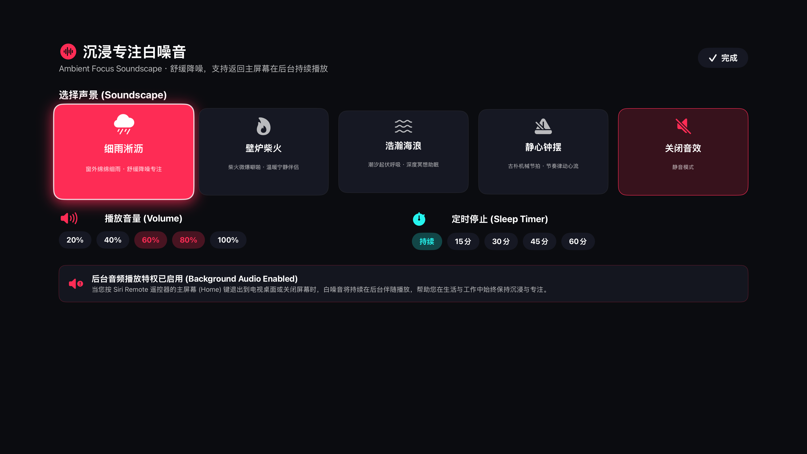
  
<em>窗外细雨、壁炉柴火、浩瀚海浪与静心钟摆 · 支持系统级后台保活混音与 Siri Remote NowPlaying 深度绑定。</em>

### 03 / 原生画中画桌面悬浮时钟

  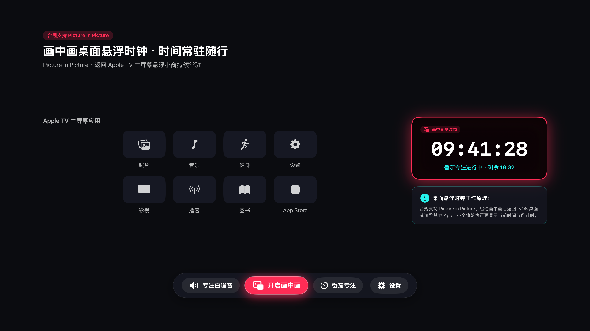
  
<em>采用 Apple 原生 <code>AVPictureInPictureController</code> 框架 · 返回系统主屏幕或跨应用使用时时间常驻屏幕角落。</em>

### 04 / 大屏番茄工作法心流系统

  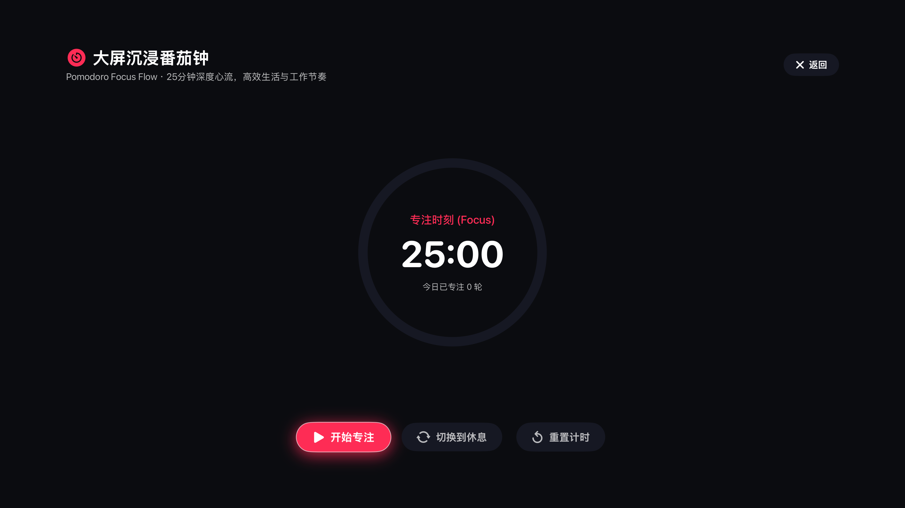
  
<em>25 分钟专注 + 5 分钟休息循环节奏 · 高对比度动态环形进度条搭配自然声景联动，赋能客厅生产力。</em>

### 05 / 极客控制台与硬件监控

  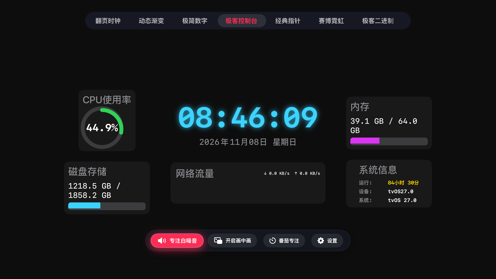
  
<em>工业极客仪表盘，实时显示网络延迟、下行/上行流量、CPU使用率、内存与磁盘负荷及系统运行时间。</em>

---

## 🌟 THLClockFramework 核心技术特性 (Features)

### 🎨 16 款独立艺术表盘
* **复古翻页时钟 (Flip Clock)**：真实落牌物理动效与拟真机械质感，还原经典的翻牌落位美学。
* **极客控制台 (Geek Dashboard)**：集成精准毫秒级时钟、系统监控指标与多维度动态面板。
* **太阳系星轨 (Solar System)**：行星沿开普勒轨道运转映射时间流转，完美适配 OLED 纯黑背景。
* **经典指针模拟 (Analog Clock)**：包豪斯极简指针与刻度，支持平滑扫秒。
* **赛博霓虹 (Cyber Neon)**：高饱和双色辉光发光字，极具未来科幻质感。
* **工业点阵 (Dot Matrix)**：经典点阵发光与像素质感，复古工控风格。
* **动态流光渐变 (Dynamic Gradient)**：呼吸般柔和多色光晕流动，与室内氛围环境光相融。
* **更多创意表盘**：复古 LCD、极简同心圆环、方块矩阵、排版艺术、十六进制色彩、二进制代码、海浪呼吸等。

### 🍃 自然声景与白噪音系统 (`ClockAmbientAudioManager`)
* **4 种高保真环绕声景**：细雨淅沥 (Gentle Rain)、壁炉柴火 (Campfire Hearth)、浩瀚海浪 (Ocean Waves)、静心钟摆 (Zen Pendulum)。
* **系统级混音与后台保活**：基于 `AVAudioSession (.playback, options: [.mixWithOthers])`，支持与系统后台音频并发混音播放。
* **Now Playing 与遥控联动**：完整接入 `MPNowPlayingInfoCenter` 与 `MPRemoteCommandCenter`，支持 Siri Remote 控制中心播放/暂停控制。
* **定时休眠伴眠 (Sleep Timer)**：支持 15 / 30 / 45 / 60 分钟定时自动淡出与停止。

### 🍅 大屏番茄工作法 (`ClockPomodoroManager`)
* **科学心流循环**：25 分钟高能专注 (Focus) + 5 分钟轻松休息 (Break) 自动化交替节奏。
* **大屏可视化进度**：高对比度动态圆环随时间平滑填充，远距离一目了然。
* **声景深度联动**：开启专注模式可自动联动播放舒缓雨声白噪音，迅速切入专注状态。

### 📺 原生画中画悬浮常驻 (`ClockPiPManager`)
* **严格遵循 Apple tvOS 原生规范**：采用 `AVPictureInPictureController` 底层框架。
* **跨应用无缝随行**：返回 Apple TV 主屏幕、切换至其他应用或观看影片时，时钟与番茄倒计时浮窗可在屏幕右上角持续常驻。

### 🛡️ OLED 防烧屏与大屏常亮保护
* **智能微像素位移**：表盘核心元素在静置时具备微像素周期位移机制，保护电视 OLED 屏幕免受灼伤。
* **智能防休眠**：激活 `UIApplication.isIdleTimerDisabled`，作为客厅氛围壁画与常驻时钟不熄屏。
* **Siri Remote 原生焦点引擎**：左右轻扫平滑切换表盘主题，向下轻扫唤起多功能 Dock 控制台，操作直观优雅。

---

## 🖼️ 实机运行表盘图赏 (Live Gallery)

  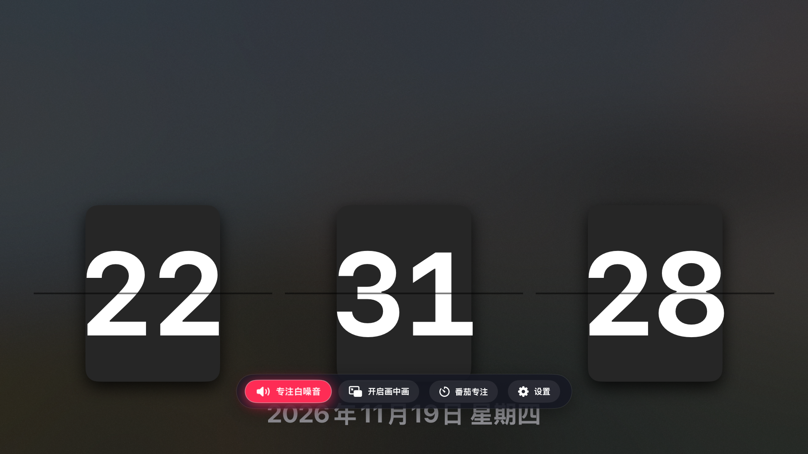
  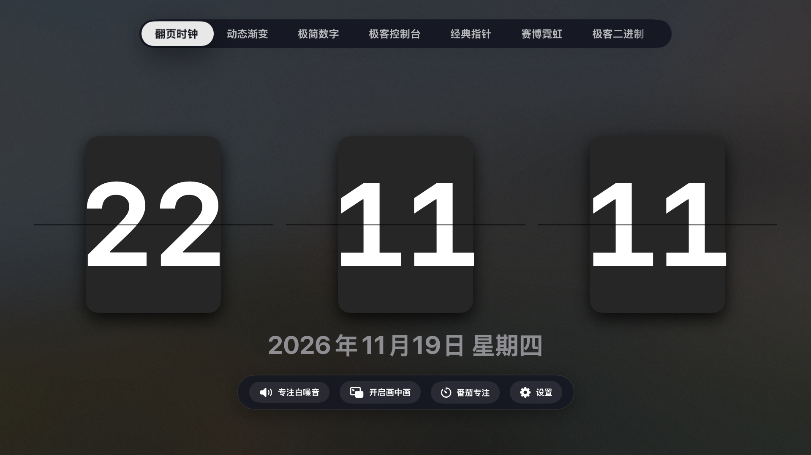
  
<b>左：复古机械翻牌时钟</b> · <b>右：太阳系天体星轨时钟</b>

  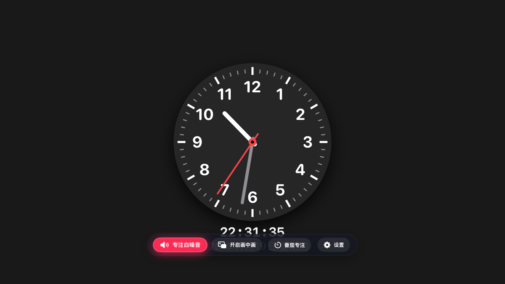
  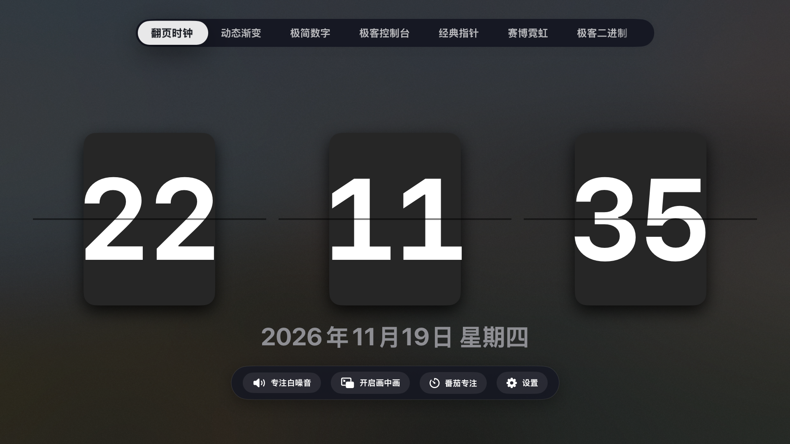
  
<b>左：包豪斯经典指针时钟</b> · <b>右：赛博霓虹辉光管时钟</b>

  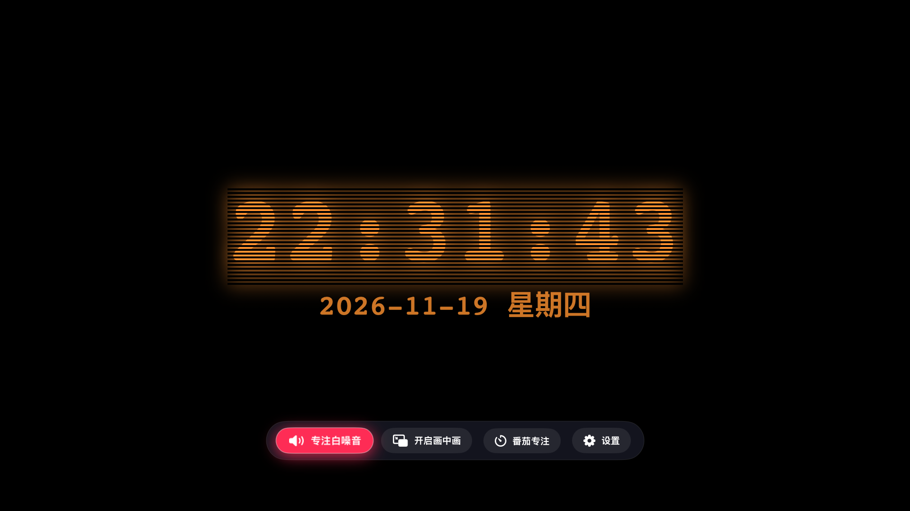
  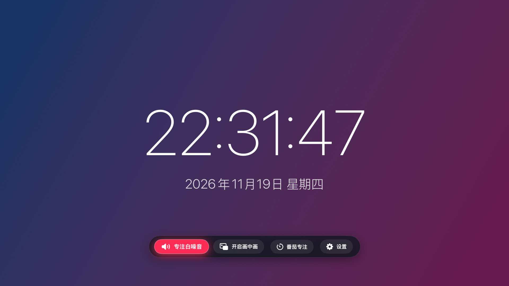
  
<b>左：工业发光点阵时钟</b> · <b>右：动态流光渐变呼吸时钟</b>

  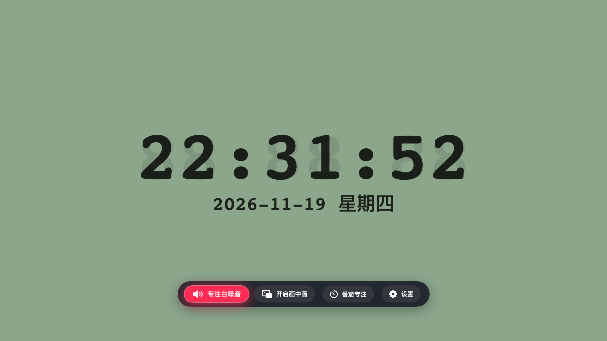
  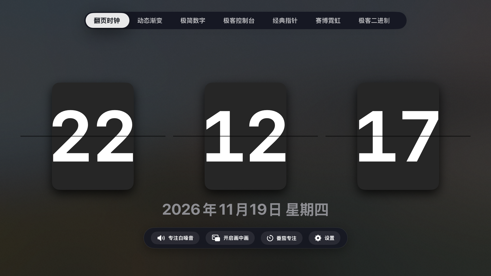
  
<b>左：经典复古液晶 LCD 时钟</b> · <b>右：极简同心圆环时钟</b>

---

## 🏛️ 技术架构与设计规范 (Architecture)

`THLClockFramework` 采用纯原生 SwiftUI + Combine 构建，遵循清晰的关注点分离与模块化设计：

* **纯本地安全运行**：无任何外部网络请求与服务器依赖，零用户隐私数据收集。
* **低能耗优化**：精心调优的视图重绘层级，静态背景与秒级跳动元素严格解耦，长时间大屏运行保持极低 CPU/GPU 占用与设备发热。
* **系统级原生融合**：全面适配 Apple tvOS 焦点引擎 (Focus Engine)、画中画控制器 (`AVPictureInPictureController`) 与系统音频控制中心 (`MPNowPlayingInfoCenter`)。
* **高合规性**：严格契合 Apple 《App Store 审核指南》与《tvOS 人机交互指南 (HIG)》。

---

## 📄 隐私政策 (Privacy Policy)

本项目严格保护用户隐私，遵守苹果 App Store 隐私合规要求：
* 纯本地工具，无外部数据采集；
* 详细政策请查阅：[隐私政策 (Privacy Policy)](PrivacyPolicy.md)。

---

## 📝 声明 (Disclaimer)

本项目遵循个人研究与技术展示规范。所有展示素材与交互逻辑均为原生开发技术呈现。如有任何技术问题或建议，欢迎提交 Issue。
